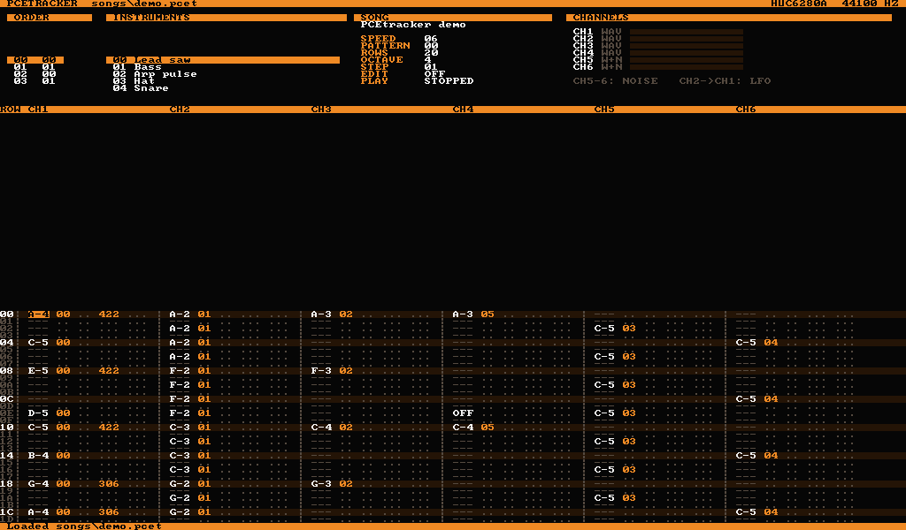

# PCEtracker

Специализированный трекер **только для PC Engine / TurboGrafx-16** (HuC6280 PSG).
Клавиатурный процесс в духе ProTracker, ориентация на реальные возможности чипа,
экспорт в WAV и в родные форматы консоли (HES, ROM).

> Статус: **этап 6 из 8** — ядро звука HuC6280, движок трекера, формат песен, рендер в WAV,
> окно трекера, экран инструмента (волны, макросы, DDA-семплы из WAV) и **экспорт HES**
> с драйвером на 6280. HES проверяется встроенной машиной 6280 при каждом экспорте;
> в сторонних эмуляторах и на консоли **ещё не проверено** — см. [docs/EXPORT.md](docs/EXPORT.md).
> Дальше — ROM (HuCard).



## Запуск

```bash
./build/pcetracker songs/demo.pcet     # открыть песню (или новое имя — новая песня)
```

ENTER — играть/стоп, SPACE — режим записи, F9/F10 — паттерны/инструмент, F12 — все клавиши.
Перетащите .wav на окно — получится DDA-семпл. Экран инструмента: [docs/INSTRUMENTS.md](docs/INSTRUMENTS.md). Ноты — две нижние/верхние
«пианинные» строки клавиатуры (по физическому положению, раскладка не важна).

Настройки — `pcetracker.cfg` (создаётся при первом запуске; Linux:
`~/.local/share/pcetracker/pcetracker/`, Windows: `%APPDATA%\pcetracker\pcetracker\`):
`scale` (масштаб окна), `fullscreen` (0/1/auto), `software_render`, `audio_buffer` (увеличьте до 2048/4096,
если звук трещит на слабом CPU), `revision` (6280 / 6280a).
> План и список вырезанного: [docs/ROADMAP.md](docs/ROADMAP.md).
> Устройство модулей: [docs/ARCHITECTURE.md](docs/ARCHITECTURE.md).

## Сборка на Linux (в т.ч. antiX i386)

```bash
sudo apt install build-essential cmake git libsdl2-dev
git clone https://github.com/GayFurryLove/PCEtracker.git
cd PCEtracker
cmake -S . -B build -DCMAKE_BUILD_TYPE=Release
cmake --build build
ctest --test-dir build --output-on-failure
```

Без `libsdl2-dev` соберутся только консольные утилиты и тесты (окно трекера пропускается).

Если `ctest --test-dir` не поддерживается (CMake < 3.20): `cd build && ctest --output-on-failure`.

## Сборка на Windows (x64)

Нужны CMake и Visual Studio Build Tools (C++). SDL2: распакуйте
`SDL2-devel-2.32.10-VC.zip` (релизы libsdl-org/SDL) в папку `deps/` — CMake найдёт его сам
и положит `SDL2.dll` рядом с `pcetracker.exe`.

Готовые сборки (Linux i386 и Windows x64) — во вкладке **Actions** → последний запуск → Artifacts.

```bash
cmake -S . -B build -A x64
cmake --build build --config Release
ctest --test-dir build -C Release --output-on-failure
```

## Отрендерить песню

```bash
./build/pcet_render songs/demo.pcet demo.wav
./build/pcet_render songs/demo.pcet p1.wav --pattern 1      # один паттерн
./build/pcet_render songs/demo.pcet hq.wav --rate 96000 --bits 24 --loops 1
```

Экспорт HES: `./build/pcet_render songs/demo.pcet demo.wav --hes demo.hes` (или `CTRL+H` в окне).

Формат песни: [docs/FORMAT.md](docs/FORMAT.md). Эффекты и макросы: [docs/EFFECTS.md](docs/EFFECTS.md).

## Послушать ядро

```bash
./build/psg_demo demo.wav                # HuC6280A, 44100 Гц, 16 бит
./build/psg_demo demo.wav --rev 6280     # ранняя ревизия чипа
./build/psg_demo demo.wav --rate 96000 --bits 24
```

Демо управляет чипом так же, как это делал бы код на консоли: записи в регистры раз в
кадр (60 Гц) и запись DDA-отсчётов по таймеру (~7 кГц). Каналы: пила с программным
затуханием, треугольный бас, DDA-«бочка», арпеджио на прямоугольнике, шумовой хэт.

## Лицензия

GPL-2.0-or-later (см. [LICENSE](LICENSE)). Ядро PSG взято из Mednafen в редакции Furnace,
ресемплер — blip_buf (LGPL-2.1+). Авторы и источники: [CREDITS.md](CREDITS.md).
